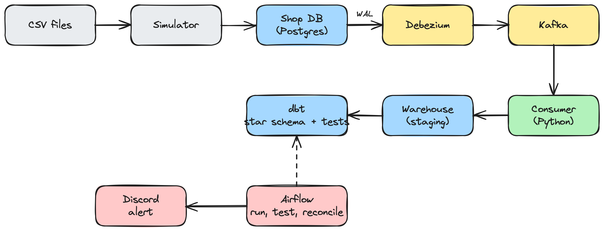

# E-commerce CDC Pipeline

This project copies every change from an online shop's database into a data warehouse, usually within 1–2 seconds. It continues my
[E-commerce Analytics Warehouse](https://github.com/dxkillmy/ecommerce-analytics-warehouse) project, which loaded the same data from a CSV once a day. Here I wanted to handle orders as they happen, and make sure nothing is lost or duplicated when something crashes.



## How it works

A small simulator replays the Online Retail II dataset into the shop database one order at a time. Debezium reads the database's write-ahead log and sends every insert, update and delete to Kafka. My Python consumer reads those events and keeps a copy of each table in a `staging` schema. dbt builds the star schema on top of that, and Airflow runs dbt plus a reconciliation check
on a schedule and posts to Discord if anything fails.

Stack: Postgres 16, Debezium 2.7, Kafka 3.8, Python, dbt 1.10, Airflow 3, Docker Compose.

## Running it

Needs Docker Desktop (I gave it 5 GB of memory) and Python 3.11. Put
`online_retail_09_10.csv` and `online_retail_10_11.csv` in `data/` first.

```bash
cp .env.example .env
python3.11 -m venv .venv && source .venv/bin/activate
pip install -r requirements.txt

docker compose up -d --wait oltp-db warehouse-db kafka connect consumer
curl -X POST -H "Content-Type: application/json" \
  --data @connectors/shop-connector.json localhost:8083/connectors

python simulator/replay_order.py --limit 500 --rate 5

cd dbt/shop_dw && dbt run --profiles-dir . && dbt test --profiles-dir . && cd ../..
python checks/reconcile.py
```

Airflow is optional: `docker compose up -d airflow`, then open
http://localhost:8081.

## Things I had to figure out

- **Orders and their items come in different topics**, and Kafka doesn't keep
  order across topics. So the consumer only mirrors tables into staging, and dbt joins them later. Staging has no foreign keys for the same reason.
- **Reading an event twice shouldn't break anything.** The consumer commits
  the Kafka offset after the database write, and only applies an event if its Postgres LSN is newer than what's already stored.
- **Checks shouldn't fail on data that's still arriving.** Reconciliation and
  relationship tests only look at rows older than 15 minutes.
- **Batching** 500 events per transaction made the consumer about 4x faster.

## Results

- **Latency:** p50 about 1 s, p95 about 1.7 s from the shop DB commit to the warehouse (500 orders, 5 orders per second).
- **Throughput:** about 1,200 events/s with batch size 1, 
about 5,000 with batch size 500 (replaying ~179k events).
- **Data checks:** 11 dbt tests, source freshness, and an       order-by-order reconciliation against the shop DB. I also compared it with my batch warehouse from the previous project: 2,050 orders matched to the cent.
- **Failure tests:** I killed the consumer, restarted Kafka, the warehouse DB and Debezium while orders were coming in. Nothing was lost or duplicated.
See [FAILURE_TESTS.md](FAILURE_TESTS.md).

Measured on a MacBook Air with 8 GB RAM.

## Limitations

- Everything runs on one laptop. With only 3.8 GB for Docker, Kafka got so
  little CPU that the consumer kept losing its connection.
- One partition per topic, so only one consumer can work at a time.
- If Debezium stays down for a long time, the shop database keeps WAL for it
  and could run out of disk. This needs an alert.

## Data

[Online Retail II](https://archive.ics.uci.edu/dataset/502/online+retail+ii)
(UCI): about 1M transactions from a UK online shop, 2009–2011.